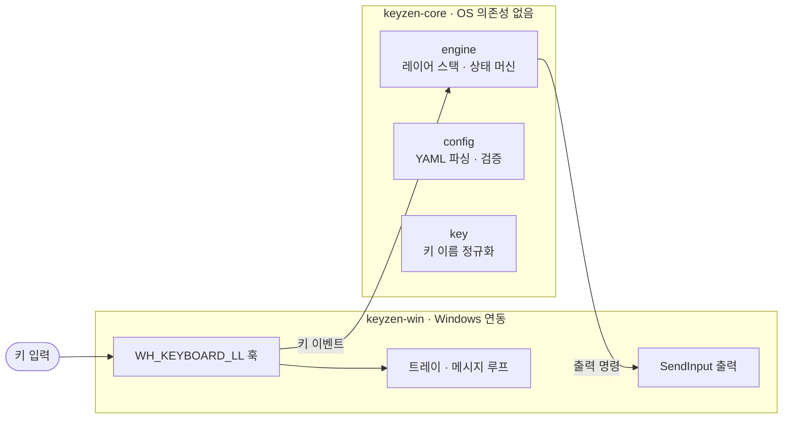

<h1 align="center">KeyZen</h1>

<h3 align="center">
레이어 스택으로 키보드를 다시 짜는, 가볍고 예측 가능한 Windows 키 리매퍼
</h3>

<p align="center">
  <b>한국어</b> &bull; <a href="docs/README.md">문서 (Docs)</a> &bull; <a href="CHANGELOG.md">변경 기록</a>
</p>

<p align="center">
  <a href="#1분-시작"><b>1분 시작</b></a> &bull;
  <a href="#설치"><b>설치</b></a> &bull;
  <a href="#키-매핑"><b>키 매핑</b></a> &bull;
  <a href="#설정-파일"><b>설정 파일</b></a> &bull;
  <a href="#트레이"><b>트레이</b></a> &bull;
  <a href="#문제가-생겼을-때"><b>문제 해결</b></a> &bull;
  <a href="#개발"><b>개발</b></a>
</p>

<p align="center">
  <a href="https://github.com/iamallyouneed/KeyZen/releases/latest"></a>
  
  
  
</p>

---

```
CapsLock 탭 / 길게        →  Esc / nav 레이어
CapsLock + H J K L        →  ← ↓ ↑ →
Space 누르는 동안          →  기호 레이어 ( [ { } ] < > … )
Quote 한 번 / 두 번        →  ' / "
LeftShift 뗀 뒤 키 하나    →  Shift + 그 키
O 떼고 H                  →  ← (nav 레이어의 one-shot)
```

KeyZen은 Windows용 키 리매퍼입니다. 유저 모드 저수준 키보드 훅(`WH_KEYBOARD_LL`)으로 입력을 잡고, **스택 기반 레이어 엔진**으로 키를 해석한 뒤 `SendInput` 으로 다시 보냅니다. 리매핑 규칙은 YAML 한 장이고, 실행 전에 검증합니다. 콘솔 없는 트레이 앱 하나로 조용히 상주합니다. 드라이버도, 서비스도, 설치 프로그램도 없습니다.

## 1분 시작

1. **받기.** [릴리스](https://github.com/iamallyouneed/KeyZen/releases/latest)에서 `KeyZen-1.0.2-windows-x64.zip` 을 받아 아무 폴더에나 압축을 풉니다. 설치 프로그램이 없습니다.
2. **실행.** `keyzen.exe` 를 실행하면 콘솔 없이 백그라운드로 뜨고, 알림 영역에 아이콘이 생깁니다.
3. **설정 고르기.** 트레이 아이콘을 마우스 오른쪽 버튼으로 클릭하고 **Choose key config...** 로 `examples\keyzen.yaml` 을 고릅니다.
4. **쳐 보기.** CapsLock을 누른 채 `H J K L` 을 치면 ← ↓ ↑ → 가 입력됩니다. CapsLock만 짧게 누르면 Esc, Space를 누르고 있는 동안에는 기호 레이어가 켜집니다.
5. **고치기.** `%APPDATA%\KeyZen\keyzen.yaml` 을 열어 고친 뒤, 트레이에서 그 파일을 다시 고르면 바로 적용됩니다.

> [!TIP]
> 고친 설정은 트레이의 **Choose key config...** 로 고르면 적용 전에 검증됩니다. 유효하지 않은 설정은 적용되지 않고 알림으로 이유를 알려 줍니다.

## 설치

KeyZen은 포터블입니다. [릴리스](https://github.com/iamallyouneed/KeyZen/releases/latest)에서 zip을 받아 압축을 풀고 `keyzen.exe` 를 실행하면 끝입니다. 설치 프로그램도, Windows 서비스도, 드라이버도 없습니다. 일반 사용자 세션용 프로그램이라 보통 관리자 권한이 필요 없습니다.

zip에는 실행 파일 하나가 들어 있습니다.

| 실행 파일 | 하는 일 |
| --- | --- |
| `keyzen.exe` | 콘솔 없이 백그라운드로 도는 트레이 런타임. 트레이 메뉴와 리매핑을 모두 담당합니다 |

받은 zip은 `SHA256SUMS.txt` 와 대조해 확인할 수 있습니다.

<details>
<summary>소스에서 직접 빌드해 패키징</summary>

Rust (edition 2024)가 필요합니다.

```powershell
cargo build --workspace
cargo test --workspace
.\scripts\package.ps1   # dist\KeyZen-<버전>-windows-<arch>.zip + dist\SHA256SUMS.txt
```

`scripts\package.ps1` 은 release 빌드 전 검사(fmt, 테스트)까지 돌린 뒤 패키징하고 결과물을 검증합니다.

</details>

## 키 매핑

설정은 `layers` 아래에 레이어를 정의하고, 각 레이어는 `키: 액션` 매핑입니다. 문자열 값은 키를 한 번 탭하는 `send` 의 축약형입니다. 전체 예시는 [examples/fullkeyzen.yaml](examples/fullkeyzen.yaml) 에 있습니다.

| 액션 | 예시 | 뜻 |
| --- | --- | --- |
| `send` | `A: B` | 키를 한 번 탭한다 (문자열 축약형) |
| `noop` | `noop: true` | 키를 소비하고 아무 입력도 보내지 않는다. 위 레이어에서 아래 레이어 fallback을 막을 때 쓴다 |
| `chord` | `chord: [Ctrl, C]` | 여러 키를 순서대로 눌렀다 역순으로 뗀다 |
| `layer_while_held` | `layer_while_held: nav` | 누르는 동안 레이어를 올리고, 떼면 내린다 |
| `layer_toggle` | `layer_toggle: nav` | 레이어를 켜고 끈다. 같은 레이어가 중복으로 쌓이지 않는다 |
| `tap_hold` | `tap: Escape` / `hold: …` | 짧게 누르면 tap, 길게 누르거나 다른 키로 인터럽트되면 hold |
| `tap_dance` | `1: Quote` / `2: DoubleQuote` | 탭한 횟수에 따라 다른 액션 |
| `one_shot_modifier` | `one_shot_modifier: Shift` | 다음 키 하나에만 모디파이어를 적용한다 |
| `one_shot_layer` | `one_shot_layer: nav` | 다음 키 하나를 지정한 레이어에서 해석한다 |

레이어 해석 규칙:

- 현재 레이어 스택의 맨 위부터 아래로 매핑을 찾습니다. 맨 아래에는 항상 `base` 가 있습니다.
- 위쪽 레이어에 키가 없을 때만 아래 레이어로 fallback합니다.
- 위쪽 레이어에서 fallback을 막고 아무 입력도 보내지 않으려면 `noop: true` 를 매핑합니다.
- `layer_while_held`, `layer_toggle`, `one_shot_layer` 의 대상은 `base` 가 될 수 없습니다.
- `tap_hold` 와 `tap_dance` 안에 또 다른 `tap_hold`/`tap_dance` 를 중첩할 수 없습니다.

`tap_hold` 동작 규칙:

- `tapping_term_ms` 안에 키를 떼면 `tap` 이 실행됩니다.
- `tapping_term_ms` 가 지나면 `hold` 가 시작됩니다.
- 누른 상태에서 다른 키를 먼저 누르면 즉시 `hold` 로 판정합니다.
- `hold` 가 `layer_while_held` 면 원래 키를 뗄 때 레이어가 내려갑니다.

## 설정 파일

`%APPDATA%\KeyZen\settings.yaml` 은 앱 설정, `%APPDATA%\KeyZen\keyzen.yaml` 은 키 매핑입니다. 트레이의 **Choose key config...** 로 다른 경로의 키 설정을 골라 `settings.yaml` 에 저장할 수 있습니다.

`settings.yaml`

```yaml
start_at_login: false
key_config_path: C:\Users\user\AppData\Roaming\KeyZen\keyzen.yaml
```

| 필드 | 뜻 |
| --- | --- |
| `start_at_login` | 로그인 시 KeyZen tray를 실행할지 (`Start at login` 메뉴와 같은 값) |
| `key_config_path` | 사용할 키 매핑 YAML 경로. 상대 경로는 `settings.yaml` 이 있는 폴더 기준으로 해석한다 |

`keyzen.yaml`

```yaml
settings:
  tapping_term_ms: 200
  tap_dance_term_ms: 180
  one_shot_timeout_ms: 1000

layers:
  base: {}
```

| 필드 | 기본값 | 뜻 |
| --- | ---: | --- |
| `tapping_term_ms` | `200` | tap-hold 키를 탭으로 볼지 홀드로 볼지 정하는 시간 (ms) |
| `tap_dance_term_ms` | `180` | 같은 키를 여러 번 탭하는 tap dance 입력을 기다리는 시간 (ms) |
| `one_shot_timeout_ms` | `1000` | one-shot 레이어·모디파이어가 다음 키를 기다리는 최대 시간 (ms) |

- `settings` 는 생략할 수 있고, `layers` 는 필수이며 `base` 레이어를 반드시 포함해야 합니다.
- 키 이름은 대소문자를 구분하지 않고 공백, `-`, `_` 는 무시합니다. `left-shift`, `left_shift`, `LeftShift` 는 모두 같은 키입니다.
- `esc`, `caps`, `lshift`/`rshift`, `lctrl`/`rctrl`, `pgup`/`pgdn`, `prtsc`, `break` 같은 alias도 됩니다. 전체 키 목록과 검증 규칙은 [docs/configuration.md](docs/configuration.md) 에 있습니다.
- 키 설정 파일은 자동으로 다시 읽지 않습니다. 고친 뒤 트레이에서 다시 고르세요.
- 앱 설정은 임시 파일에 쓴 뒤 교체하는 방식으로 저장되고, Pause 상태는 저장되지 않고 현재 실행 세션에만 유지됩니다.

## 트레이

트레이 메뉴 라벨과 동작:

트레이 메뉴 맨 위에는 현재 적용 중인 키 설정 파일과 매핑 수가 표시됩니다 (예: `Config: mykeyzen.yaml (20 keys)`). 설정을 읽지 못했으면 `(not loaded)`, 매핑이 하나도 없으면 `(no mappings)`로 표시됩니다.

| 메뉴 | 하는 일 |
| --- | --- |
| `Pause` | 체크된 동안 리매핑을 멈추고 키를 그대로 통과시킨다. 전환할 때 눌린 합성 키, 레이어, tap-hold, tap dance, one-shot 상태를 초기화한다 |
| `Start at login` | 현재 사용자의 로그온 작업 `\KeyZen\Autorun for <사용자명>` 을 등록하거나 삭제한다 (3초 지연) |
| `Choose key config...` | `.yaml`/`.yml` 파일을 골라 즉시 검증하고, 유효하면 바로 적용한다. 설정이 없어 자동으로 일시정지된 상태였다면 적용 후 리매핑을 재개하고, 사용자가 직접 Pause한 경우에는 유지한다 |
| `Quit` | 눌린 합성 키와 엔진 상태를 정리하고 종료한다 |

- `keyzen.exe` 를 처음 실행하면 `%APPDATA%\KeyZen\settings.yaml` 과 `%APPDATA%\KeyZen\keyzen.yaml` (빈 `base` 레이어)을 자동으로 만듭니다.
- 저장된 키 설정이 없거나 유효하지 않으면 tray는 paused 상태로 시작합니다. 그 상태에서도 **Choose key config...** 로 유효한 설정을 골라 복구할 수 있습니다.
- tooltip은 실행 중 `KeyZen`, 일시정지 중 `KeyZen (Paused)` 로 표시됩니다. 로그인 직후 Explorer가 아직 준비되지 않아 아이콘 등록에 실패해도 앱은 종료하지 않고 스스로 다시 시도합니다.
- 시작, 트레이 등록, 런타임 상태, 오류는 `%APPDATA%\KeyZen\keyzen.log` 에 기록됩니다. 로그가 5MB를 넘으면 `keyzen.log.1` 로 이동합니다.
- 실행 중에는 `tray.running` 마커가 있고 정상 종료 시 제거됩니다. 강제 종료나 프로세스 충돌로 마지막 기록을 남기지 못하면 다음 실행 로그에 이전 세션이 정상 종료되지 않았다고 남습니다.

## 문제가 생겼을 때

| 증상 | 해결 |
| --- | --- |
| 키가 바뀌지 않는다 | 트레이 메뉴 맨 위의 `Config:` 줄에서 설정 파일과 매핑 수를 확인하세요. `(no mappings)`면 매핑이 없는 설정입니다. `Pause` 가 체크됐는지도 확인하세요 |
| 일부 앱에서만 리매핑이 안 된다 | 그 앱이 관리자 권한으로 실행 중이면 KeyZen도 관리자 권한으로 실행해야 합니다 |
| 설정을 고쳤는데 반영이 안 된다 | 트레이 → **Choose key config...** 로 파일을 다시 고르세요. 파일은 자동으로 다시 읽지 않습니다 |
| 잘못된 설정으로 키가 이상하게 나온다 | `Pause` 로 멈추고 설정을 고친 뒤 다시 고르세요. 잘못된 설정이면 tray가 paused 상태로 시작합니다 |
| 트레이 아이콘이 안 보인다 | 이미 실행 중인 인스턴스가 있는지 확인하세요. 중복 실행이면 안내 창이 뜨고 새 프로세스는 종료됩니다. 그 밖에는 `keyzen.exe` 가 실행 중인지 확인하고, Explorer가 다시 뜨면 아이콘을 다시 등록합니다 |
| 리매핑이 멈췄다는 알림이 뜬다 | 리매핑 런타임이 오류로 중단된 상태입니다. `%APPDATA%\KeyZen\keyzen.log` 를 확인하고 KeyZen을 다시 실행하세요 |
| 원본 키와 리매핑 키가 같이 나온다 | 다른 키 리매퍼나 입력기가 같은 키를 함께 잡고 있지 않은지 확인하세요 |
| 원인을 모르겠다 | `%APPDATA%\KeyZen\keyzen.log` 를 확인하세요. 비정상 종료 여부도 다음 실행에 기록됩니다 |
| 완전히 끄고 싶다 | 트레이 메뉴에서 `Quit` 을 고르세요 |

그래도 안 되면 [이슈](https://github.com/iamallyouneed/KeyZen/issues)로 알려 주세요. 설정 항목별 자세한 설명은 [docs/configuration.md](docs/configuration.md) 에 있습니다.

## 특징

- **스택 기반 레이어.** 맨 위부터 키를 찾고, 없으면 아래 레이어로 fallback합니다. 맨 아래에는 항상 `base` 가 있습니다.
- **누르는 방식까지 매핑.** tap-hold, tap dance, one-shot 레이어·모디파이어, chord, `noop` 까지 YAML로 표현합니다.
- **가볍게.** 유저 모드 훅과 `SendInput` 만 씁니다. 드라이버, 서비스, 커널 컴포넌트가 없습니다.
- **검증되는 설정.** 실행 전에 레이어 참조, 중첩 금지 같은 규칙을 검사하고, 트레이에서 설정을 고를 때 유효하지 않으면 적용하지 않습니다.
- **조용한 상주.** 콘솔 없는 트레이 런타임, Pause 즉시 중단, Windows Task Scheduler 기반 로그인 자동 실행.

## 개발



| 크레이트 | 내용 |
| --- | --- |
| `crates/keyzen-core` | OS 의존성 없는 엔진. YAML 파싱·검증(`config`), 레이어 스택과 tap-hold·tap dance·one-shot 상태 머신(`engine`), 키 이름 정규화(`key`) |
| `crates/keyzen-win` | Windows 연동과 `keyzen` 바이너리. 리매핑 런타임(`platform`: 훅·`SendInput`·키 매핑), 트레이(`tray`: 창·메뉴·아이콘), 자동 실행 작업(`startup`), 앱 설정(`app_settings`), 단일 인스턴스(`single_instance`), 진단 로그(`diagnostics`) |

```powershell
cargo test --workspace                    # 테스트 (examples 설정 검증 포함)
cargo run                                 # 트레이 실행 (로그: %APPDATA%\KeyZen\keyzen.log)
$env:KEYZEN_DEBUG_EVENTS = "1"; cargo run # 이벤트 진단을 로그에 기록
cargo clippy --workspace --all-targets -- -D warnings
```

`KEYZEN_DEBUG_EVENTS=1` 로 실행하면 각 입력 이벤트의 경과 시간(ms), 키와 이벤트 종류, 원본 입력 억제 여부, 출력 명령, 활성 레이어 스택이 `%APPDATA%\KeyZen\keyzen.log` 에 기록됩니다. 타이머·리셋 이벤트는 출력 명령이나 진단이 있을 때만 찍힙니다. 설정하지 않으면 키 로깅은 없습니다.

릴리스 패키지는 `.\scripts\package.ps1` 이 만듭니다. `dist\KeyZen-<버전>-windows-<arch>.zip` 과 `dist\SHA256SUMS.txt` 가 생성되고, 패키징된 실행 파일까지 검증합니다.

## 알려진 한계

- Windows 전용입니다.
- 드라이버나 서비스가 아니라 일반 사용자 세션 프로그램입니다. 관리자 권한으로 실행된 앱의 키를 바꾸려면 KeyZen도 관리자 권한으로 실행해야 합니다.
- `tap_hold` 와 `tap_dance` 안에 다른 `tap_hold`/`tap_dance` 를 중첩할 수 없습니다.
- KeyZen은 동시에 하나만 실행됩니다 (`Local\KeyZen.Runtime` 뮤텍스로 보장). 이미 실행 중이면 새 인스턴스는 실행 중인 트레이에 알림을 보내고 종료합니다.
- 키 설정 파일 변경을 자동으로 감지하지 않습니다. 고친 뒤 트레이에서 다시 골라야 반영됩니다.
- Pause 상태는 앱 설정에 저장되지 않습니다. 다시 실행하면 항상 실행 중 상태로 시작합니다.

## 라이선스

MIT. Copyright (c) 2026 KeyZen contributors. 버전별 변경은 [CHANGELOG.md](CHANGELOG.md) 에 있습니다.
